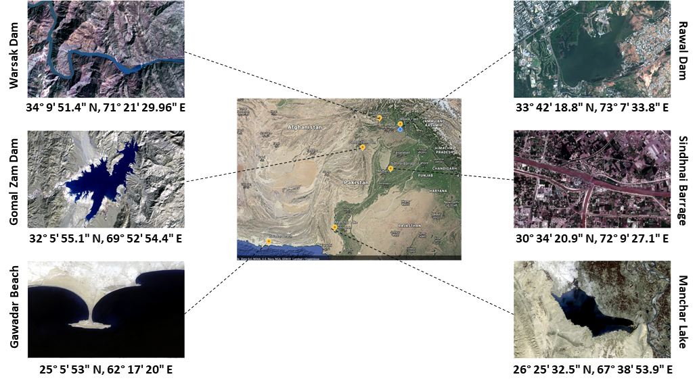
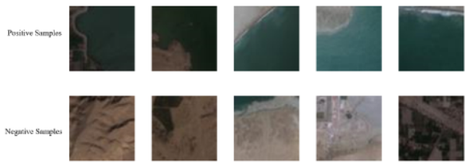
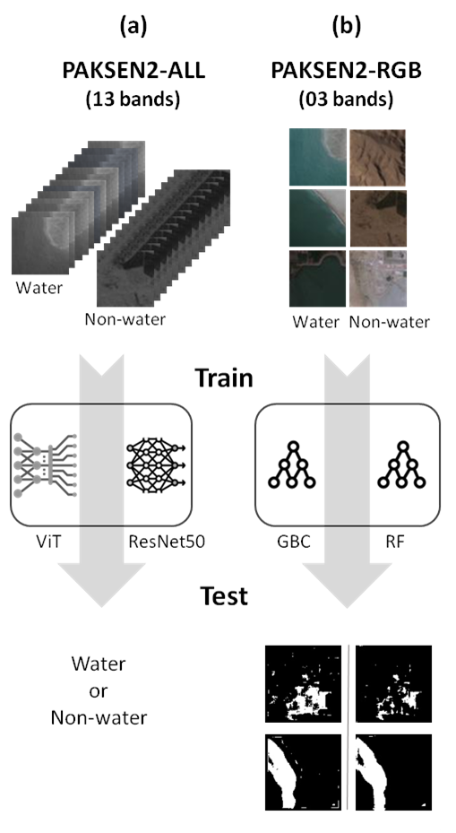

<div align="center">

# 🛰️ PAKSEN2 Water Body Classification
### ResNet50 RGB Implementation and Published Research

**Sentinel-2 imagery | Water/Non-water classification | Pakistan**

[](https://doi.org/10.1109/IBCAST59916.2023.10712981)
[](https://github.com/rafiamalik12/PAKSEN2_Water_Dataset)
[](LICENSE)

**Rafia Malik | Muhammad Shahzad | Shahrukh Malik**
</div>

## 🌊 Overview

PAKSEN2 brought together Sentinel-2 imagery of selected water resources in Pakistan for water-body classification and segmentation research. Our IBCAST paper introduced the dataset and compareD classical machine learning, ResNet50, and an attention-based model for water-body analysis.

This repository provides the **ResNet50 RGB implementation** associated with that research. It is a fork of [the original RGB code repository](https://github.com/rafiamalik12/Fine_Tuning_ResNet50_on_PAKSEN2_RGB), with documentation connecting the code to the published study.

> **Repository scope:** the paper’s ResNet50 and attention-based experiments use the **13-band PAKSEN2-ALL** dataset. The scripts here take **three-channel RGB** images and use different training settings. The published 81% ResNet50 accuracy is not a measured result from this RGB fork.

## 🗺️ The PAKSEN2 dataset

The study selected six Sentinel-2 tiles covering water resources across Pakistan, including Warsak Dam, Gomal Zam Dam, Gwadar Beach, Rawal Dam, Sindhani Barrage, and Manchar Lake. Images were selected across seasons with reported cloud cover below 2%.



| Property | Reported dataset description |
| :---: | :---: |
| Source | Sentinel-2 satellite imagery |
| Source tiles | Six |
| Patch size | 64 × 64 pixels at 10 m sampling, approximately 640 × 640 m |
| Samples | 54,176 per dataset variant, as listed on the original dataset page |
| Class balance | 27,088 positive and 27,088 negative samples per variant |
| PAKSEN2-RGB | Three bands: B02, B03, B04 |
| PAKSEN2-ALL | All 13 Sentinel-2 bands, with coarser bands interpolated to a 10 m grid |
| Labelling rule | At least 70% water pixels: Water; below 70%: Non-water |

### Actual class examples



*Actual examples from the main PAKSEN2 page. The top row is labelled Positive Samples; the bottom row is labelled Negative Samples. Individual mask coverage values are not supplied for these examples.*

**Data access:** the [main dataset page](https://github.com/rafiamalik12/PAKSEN2_Water_Dataset) states that the full dataset is available on request. This fork does not bundle dataset images, masks, split CSVs, or trained weights.

## 🖊️ From imagery to labelled patches

The paper describes the following preparation process:

1. Acquire Sentinel-2 tiles for the selected water resources.
2. Create RGB and 13-band composites, using QGIS cubic-spline interpolation to align coarser bands to the 10 m grid.
3. Annotate water bodies with polygons in [LabelMe](https://github.com/shahrukh27/labelme) and save binary water masks.
4. Divide the imagery into 64 × 64 patches and assign Water / Non-water labels using the 70% water-coverage threshold.

[Data Processing and Labelling Pipeline](assets/Pakistan%20Water%20Bodies%20Dataset%20Workflow.png)

## 🧪 Methods in the published study

<div align="center">

</div>

*Reproduced from paper Figure 3. The figure depicts two input routes and their corresponding outputs. It describes the published study, rather than the code coverage of this fork.*

| Study component | Dataset variant | What is included here |
| --- | --- | --- |
| Random Forest and Gradient Boosting | PAKSEN2-RGB | Paper context; implementations are not included in this fork. |
| Published ResNet50 experiment | PAKSEN2-ALL, 13 bands | Paper context; the multispectral loader is not included here. |
| Attention-based experiment, labelled ViT in the paper | PAKSEN2-ALL, 13 bands | Paper context; implementation is not included here. |
| This repository’s ResNet50 | PAKSEN2-RGB, 3 channels | Training and test scripts are included. |

The paper calls its attention-based model “ViT”; Table IV specifies the checkpoint `microsoft/swin-tiny-patch4-window7-224`. This page retains the paper’s result label and states the checkpoint explicitly.

## 📊 Results reported in the paper

[Original paper Figure 4 comparing the reported test accuracies](assets/paper_results.png)

| Method | Dataset variant | Reported test accuracy |
| :---: | :---: | :---: |
| Random Forest | RGB | 42% |
| Gradient Boosting Classifier | RGB | 44% |
| ResNet50 | ALL, 13 bands | 81% |
| ViT, paper’s label | ALL, 13 bands | 99.74% |

Source: Tables V–VI. These are **published results**, not rerun measurements. 

## :file_folder: Repository guide

| Path | Purpose |
| --- | --- |
| `src/__config__.py` | python script to load config.yml |
| `src/__imports__.py` | python script to load all required libraries |
| `utilities/config.yml` | contains parameter descriptions |
| `requirements.txt` | python modules and their versions; screenshot of used python environment |
| `src/test_ResNet50_classifer_on_PAKSEN2_RGB.py/` | Python script to train Resnt50 on RGB input |
| `src/train_ResNet50_classifer_on_PAKSEN2_RGB.py/` | Python script to score trained Resnt50 on RGB input |
| `assets/` | Images, Pipelines |

## 📚 Citation

If you use PAKSEN2 or build on the associated study, please cite:

R. Malik, M. Shahzad, and S. Malik, “Supervised Classification of Water Bodies: Analyzing Various Methods Through a Case Study of Water Resources in Pakistan,” in *2023 20th International Bhurban Conference on Applied Sciences and Technology (IBCAST)*, 2023, pp. 339–344. DOI: [10.1109/IBCAST59916.2023.10712981](https://doi.org/10.1109/IBCAST59916.2023.10712981).

```bibtex
@inproceedings{malik2023paksen2,
  author    = {Malik, Rafia and Shahzad, Muhammad and Malik, Shahrukh},
  title     = {Supervised Classification of Water Bodies: Analyzing Various Methods Through a Case Study of Water Resources in Pakistan},
  booktitle = {2023 20th International Bhurban Conference on Applied Sciences and Technology (IBCAST)},
  year      = {2023},
  pages     = {339--344},
  doi       = {10.1109/IBCAST59916.2023.10712981}
}
```
